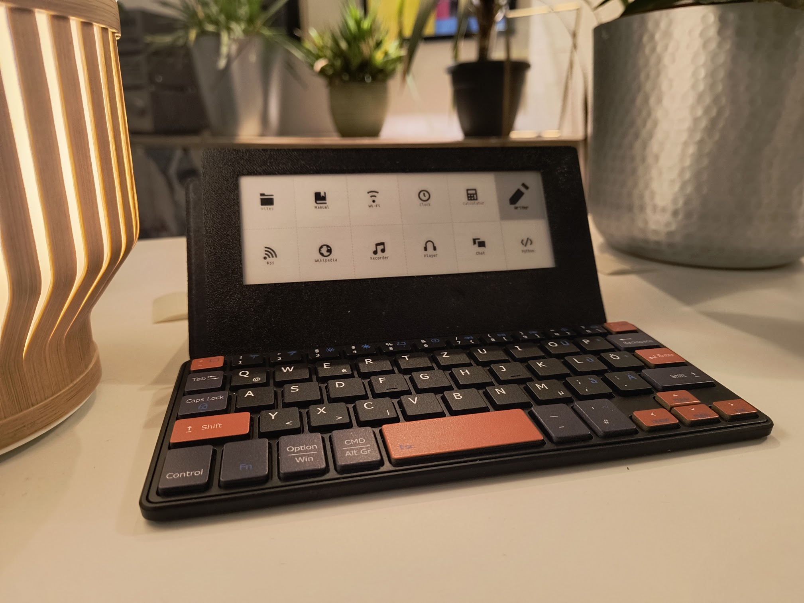
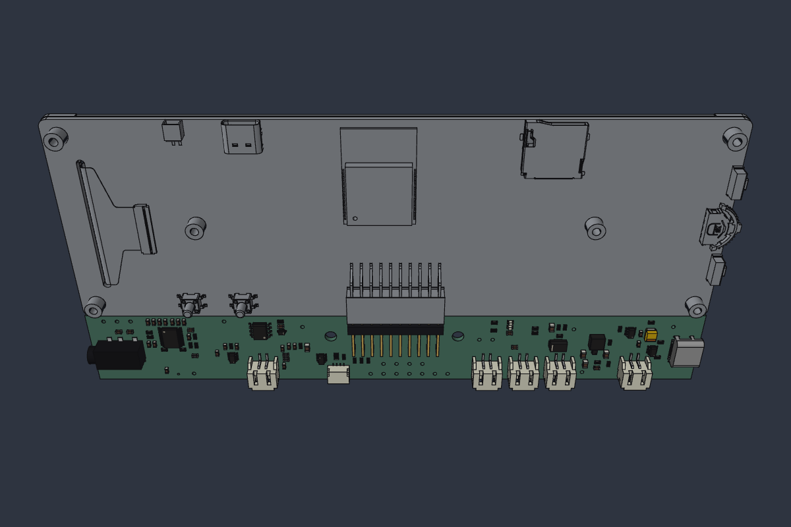
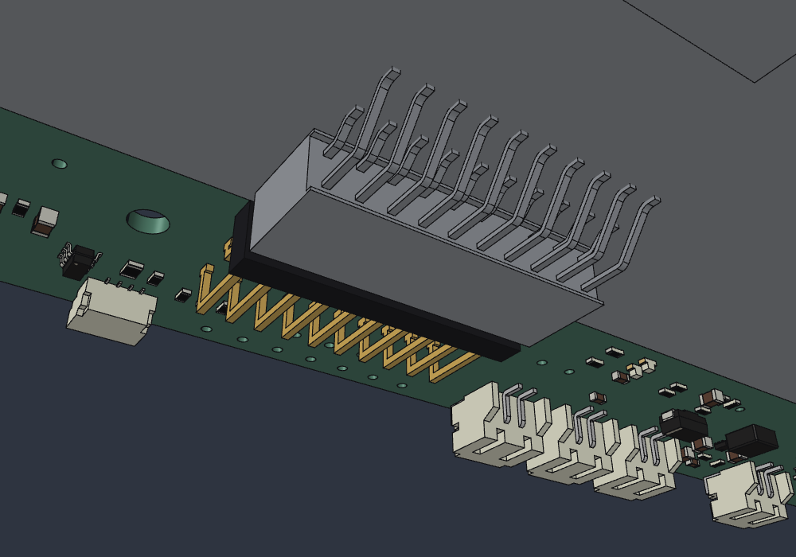
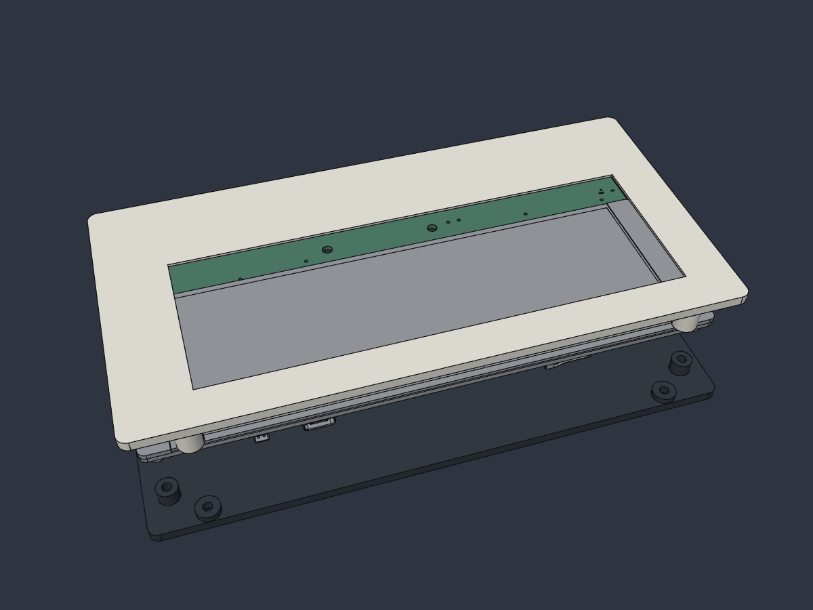

# SolarWriter

SolarWriter is a compact e-paper writing computer running SolarOS. It combines an
Elecrow CrowPanel 5.79-inch ESP32-S3 display with a custom I/O board that adds USB
keyboard connectivity, audio, battery monitoring and solar charging.

This release shares the mechanical files so designers can explore enclosure
ideas for SolarWriter.

## Electronics assembly

[solar_writer_assembly.step](solar_writer_assembly.step) contains the CrowPanel
and SolarWriter I/O board in their assembled positions. Use it as the reference
for board dimensions, mounting holes and connector access.

The close-up below shows the I/O board plugged directly into the CrowPanel.
It can also connect through a ribbon cable, allowing you to position the I/O
board elsewhere in your enclosure.

## Enclosure reference

[enclosure.step](enclosure.step) contains the front and back covers of a simple
enclosure with open sides. The image shows the covers around the electronics;
the STEP file contains only the covers.

Printable versions: [front_cover.stl](front_cover.stl) and
[back_cover.stl](back_cover.stl). All models use millimetres.

Use these files as a starting point for your own enclosure design. New shapes,
materials and approaches are welcome!
